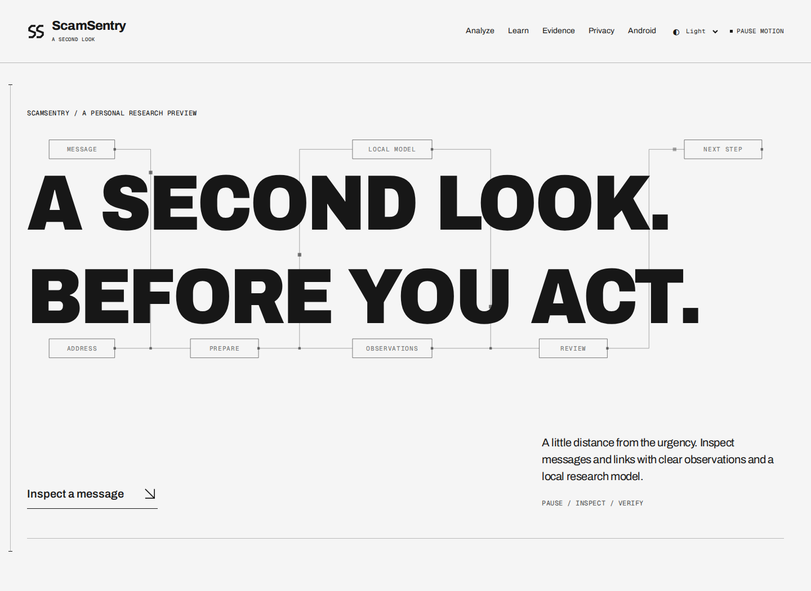

# ScamSentry

**A second look. Before you act.**

ScamSentry is an academic research preview for inspecting suspicious messages and links. It presents text observations, lexical URL evidence, and a calibrated local classifier for historical English short messages. Use trusted contact details to verify consequential requests before acting.

[Open the browser app](https://scamsentry-inspect.vercel.app/) · [Download the Android research preview](https://github.com/DevenGaikwad/ScamSentry/releases/tag/v0.3.0-preview) · [Evidence and limits](docs/MODEL_CARD.md)

## Two ways to inspect

| | Browser 0.4.0 | Android 0.3.0-preview |
| --- | --- | --- |
| Start | Paste or type a message or link | Type, paste, share text, or review text from a selected screenshot |
| Processing | Local Web Worker after app and model assets load | On-device Kotlin analysis and bundled Latin OCR |
| Presentation | Light/dark palettes, readable headline, right-angle pipeline, pointer brackets, and optional page motion | Native Compose, shared palettes and mark, optional pipeline motion, phone and wider-window layouts |
| Retention | Draft and result stay in memory. Browser theme and motion preferences can persist. | History starts off. When enabled, save up to 200 redacted summaries by choice. |
| Output | Review and download a redacted report | Review and share a redacted report |

Choose a compatible **arm64-v8a**, **x86_64**, or **universal** APK from the Android release. It requires Android 8 / API 26 or newer and uses a disposable TEST signing identity. Check the published SHA-256 sums and signing compatibility before installing.

Android blocks in-place updates from the previous preview because the two releases use different test certificates. Preserve any local summaries you need before replacing an earlier installation.

## Current screens

[Dark browser view](assets/evidence/v4/browser-home-dark.png) · [Mobile browser view](assets/evidence/v4/browser-home-mobile.png) · [Actual motion recording](https://github.com/DevenGaikwad/ScamSentry/releases/download/v0.3.0-preview/ScamSentry_Editorial_Motion.webm)

  
  
  

The home and OCR captures show the release-like emulator build. The dark editor capture comes from debug instrumentation on the same source.

## Model evidence

The shipping estimator is **ss-char-lr-0.1.0**, a character TF-IDF model with multinomial logistic regression and scalar-temperature calibration. The frozen historical test had 861 records across 813 groups. Macro F1 was **90.38%**, accuracy **96.98%**, and smishing-like recall **65 / 75**. These figures describe the historical evaluation.

The [v4 model comparison](docs/ML_V4_RESULTS.md) completed 12 grouped fold fits. Each configuration missed the predefined smishing recall floor. The shipping model remains the approved baseline. The research scope is English short messages. See the [model card](docs/MODEL_CARD.md) and [historical results](docs/EVALUATION_RESULTS.md) for severe noise sensitivity, evaluation limits, and class counts.

## Build and review

- [Android setup and test commands](docs/SETUP_WINDOWS.md) · [Browser build and deployment](docs/WEB_DEPLOYMENT.md)
- [Android privacy](docs/PRIVACY.md) · [Browser privacy](docs/WEB_PRIVACY.md) · [Dataset and attribution](docs/DATA_SOURCES.md)
- [Physical-device checklist](docs/DEVICE_CHECKLIST.md) · [Release audit](docs/V4_ACCEPTANCE.md) · [Project checkpoint](docs/PROJECT_STATE.md) · [Release history](https://github.com/DevenGaikwad/ScamSentry/releases)

Deven Sachin Gaikwad · B.Tech Electronics and Communication Engineering (AI and ML) · DES Pune University.
