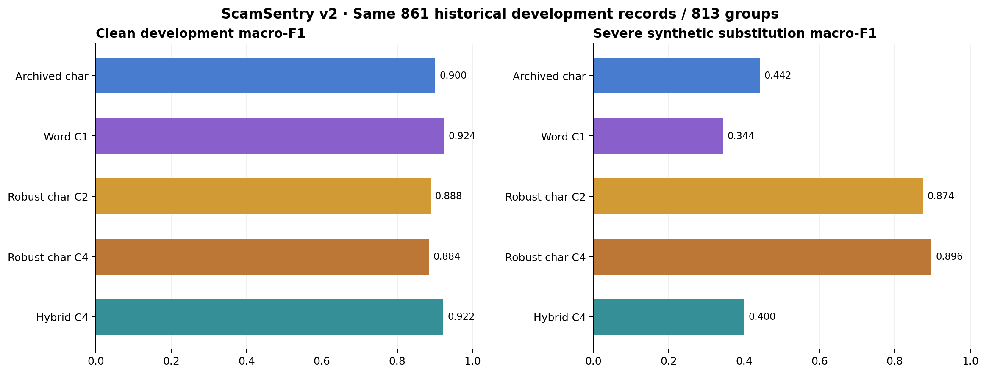

# ScamSentry

**A second look before you act.**

A native Android app and local-browser companion for inspecting suspicious messages and links. English message resemblance, transparent observations, actual destination hosts and uncertainty stay separate. Inputs are reviewed locally; no inbox access, message-upload service or automatic link opening is required.

[Verification workflow](https://github.com/DevenGaikwad/ScamSentry/actions) · [Research preview releases](https://github.com/DevenGaikwad/ScamSentry/releases) · [Model card](docs/MODEL_CARD.md) · [Privacy](docs/PRIVACY.md) · [Browser privacy](docs/WEB_PRIVACY.md)

## What v0.2.0 changes

- Repairs context suppression: an unrelated educational label or earlier “never share” warning cannot hide a new affirmative secret request.
- Uses one versioned analysis contract across Python, Kotlin and TypeScript, including short OCR, unsupported scope, weak features, unavailable models and the exact 40-link limit.
- Adds fail-closed repository/archive validation with explicit executed and not-applicable stages.
- Improves native OCR ownership and all eight EXIF orientations, transactional 200-summary retention, independent redacted exports, adaptive navigation and focused screen files.
- Adds a functional React/TypeScript browser tool with local worker inference, digest-checked assets, request invalidation, explanations and redacted downloads.
- Evaluates eight new linear configurations through grouped folds and separate calibration, retaining the approved model until promotion is defensible.

## Evidence and scope

The deployed estimator remains **`ss-char-lr-0.1.0`**, SHA-256 `14927b442dc9f33a35ad7086bd522b87e1110a73a6d1b2826b73ac1bf1a8a8fa`. Its historical grouped test contains 861 records / 813 designated groups: macro-F1 **90.38%** (group-bootstrap 95% CI 86.1–94.5%), with smishing recall **65/75**. This is model-only historical evidence, not current Indian campaign protection or verified authenticity. [Full historical results](docs/EVALUATION_RESULTS.md).

The v2 development comparison uses a different, explicitly exploratory role: 861 records / 813 groups, with the known historical test excluded from scoring.

| Candidate | Development macro-F1 | Smishing recall | Severe synthetic-substitution macro-F1 |
|---|---:|---:|---:|
| Preserved character baseline | 90.00% | 68/75 | 44.15% |
| Word C1 | 92.43% | 70/75 | 34.35% |
| Noise-trained character C4 | 88.39% | 63/75 | 89.62% |
| Hybrid C4 | 92.18% | 70/75 | 39.98% |

These trade-offs do not justify a forced model replacement. [Complete counts, uncertainty and policy coverage](docs/MODEL_COMPARISON.md) · [Preregistered plan](docs/ML_OPTIMIZATION_PLAN.md) · [Search record](docs/HYPERPARAMETER_SEARCH.md) · [Metric definitions](docs/METRIC_DEFINITIONS.md).



English short messages are the research scope. Marathi, Hindi and Hinglish are not validated. URL analysis is lexical only. Browser screenshot OCR and PWA behavior are not included; native Android retains bundled ML Kit with reviewable text. Physical-phone performance, first-use offline OCR, large-font accessibility and 16 KB runtime behavior require their own evidence. See [current gates](docs/GATE_REPORT.json); a passing unit test does not imply every device gate passed.

## Run the browser companion

Use Node 24. From `web/`:

```sh
npm ci
npm run typecheck
npm run lint
npm test
npm run build
npm run preview
```

Open the displayed localhost URL. The model downloads as a public static asset and runs in a dedicated worker. Draft input remains in memory. [Architecture](docs/WEB_ARCHITECTURE.md) · [Deployment](docs/WEB_DEPLOYMENT.md).

Public Vercel hosting is conditional: account Hobby status was observed, but the target team requires connector authorization. No paid plan, trial, domain, database or credits were activated. No live deployment URL is claimed until verified. [Zero-cost review](docs/ZERO_COST_DEPLOYMENT_CHECKLIST.md).

## Build Android

JDK 21, Android SDK platform 37.0, Build Tools 36.0.0. Compile SDK 37, target 36, minimum 26. Stable upgrade group: AGP 9.5.1, Gradle 9.6.0, Kotlin/Compose compiler 2.4.21, Compose BOM 2026.09.00, Material 3 1.4.0, Room 2.8.5, DataStore 1.3.0, Activity 1.13.0, Lifecycle 2.11.0. Navigation Compose 2.9.5 and bundled Latin ML Kit 16.0.1 are retained.

From `android/`:

```sh
./gradlew :core-analysis:test :app:testDebugUnitTest :app:lintDebug
./gradlew :app:assembleDebug :app:assembleDebugAndroidTest :app:assembleRelease
./gradlew :benchmark:assembleBenchmark
```

Windows uses `gradlew.bat` with the same tasks. The wrapper was regenerated through Gradle and its distribution digest is pinned. [Windows setup](docs/SETUP_WINDOWS.md) · [Dependency review](docs/DEPENDENCIES.md).

Installable research releases use **disposable test signatures**, with arm64, x86_64 and universal APKs, checksums and a source-commit inventory. They are separate from owner-managed production signing. A different preview signing identity may require uninstalling a previous build. Release assets belong on the Releases page; APKs, datasets and signing secrets do not belong in source history.

## Reproduce public checks

Python 3.12, from the repository root:

```sh
python -m pip install -r ml/requirements-lock.txt
python -m pip install --no-deps -e ml
python -m pytest ml/tests -q
python scripts/validate_project.py --mode repository --format json
```

An extracted ZIP uses `--mode archive`. No Git initialization or private `.joblib` is required for fit/export checks. Tiny fictional training fixtures exercise actual scikit-learn fitting and portable arithmetic. The archived 24 model/policy fixtures remain separate from the 53 complete v2 domain cases. Word and hybrid block exports also have synthetic cross-platform parity checks.

Browser workflow tests: from `web/`, run `npx playwright install --with-deps chromium` then `npm run test:e2e`. Android instrumentation: `./gradlew :app:connectedDebugAndroidTest` with a functioning device/KVM emulator. [Test matrix](docs/TEST_MATRIX.md) · [Performance protocol](docs/PERFORMANCE.md).

Real-data experiments are opt-in, require the reviewed source and frozen partitions, and do not run during ordinary CI. `python -m scamsentry_ml.optimize_v2 --config ml/configs/v2/search.json` refuses to overwrite an existing run. Create a new run ID to reproduce; preserve the declared grid and plan. No raw corpus is redistributed.

## Provenance and credit

Original preview archive SHA-256: `fbfc705ce7959c5ae48c96942475c45f3d39416189150e2123888f52f6766dca`. Original local baseline commit: `499fa7879d499a715306424d0e95da2b2c554158`, preserved under `baseline-0.1.0`. Frozen historical documents remain in [docs/history/0.1.0](docs/history/0.1.0). The complete attached [v2.1 implementation specification](docs/UPGRADE_SPEC_V2_1.md) is preserved.

Deven Sachin Gaikwad · B.Tech ECE, AI/ML · DES Pune University. Dataset: Sandhya Mishra and Devpriya Soni (2022), [Mendeley Data V1](https://data.mendeley.com/datasets/f45bkkt8pr/1), DOI 10.17632/f45bkkt8pr.1, CC BY 4.0. Changes include minimization, deduplication, grouping, quarantine and normalization; no endorsement is implied. Inter and Space Grotesk retain SIL OFL notices. [MIT code licence](LICENSE) · [Full third-party notices](THIRD_PARTY_NOTICES.md).
