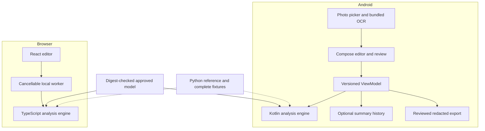

# ScamSentry architecture

The native foundation remains Kotlin/Compose, Material 3, Navigation Compose, ViewModel, coroutines/Flow, Room and DataStore. Domain behavior is Android-independent in `core-analysis`; bitmap/URI/OCR, lifecycle, persistence and sharing stay in the app layer. Coherent editor, result, history, information and component files replace the original all-in-one screen file.

`AnalysisEngine` owns bounded input validation, script/feature quality, context observations, conservative URL extraction, estimate use, limitations and final-category precedence. The Python and TypeScript references follow the same schema-2 contract. A standalone address gets lexical observations, zero/weak features cannot produce reassuring model-only interpretation, exactly 40 addresses remain fully inspected, and a 41st match sets an explicit limitation. A concrete secret request stays visible even when statistical interpretation is unavailable.

The approved schema-1 model is an immutable digest-checked JSON asset. Loading stays off the UI thread and is cached. The Kotlin loader discards its parsed JSON, keeps numeric arrays/inverse vocabulary, streams counts, and computes explanations with the same active weights as inference. Model loading failures become an explicit limited state. Research schema-2 word/hybrid blocks remain separate and have tiny actual-fit cross-platform tests.

`MessageModel` and `OcrSource` define focused seams; constructor/factory ownership remains simple. The ViewModel serializes model initialization, OCR ownership and history operations, invalidates old work by input version, and checks cancellation before installing a result. Raw drafts are not placed in persistent navigation/saved-state storage. Window-size classes choose compact bottom navigation, wider navigation rails and paired editor/result panes on expanded windows.

Room schema 3 keeps redacted summaries only. Insert/prune is transactional, migrations preserve legacy summary metadata, and optional-history disabling clears data. FileProvider exposes only reviewed redacted exports with independent names and bounded cleanup. All eight EXIF orientations are applied to pixels before OCR/review.

The static React companion runs the same approved estimator in a worker, with its own cancellation/request IDs and content-addressed assets. [Browser architecture](WEB_ARCHITECTURE.md) documents deployment, CSP and privacy details. The benchmark module prepares real release-like measurements; it supplies no fabricated profile or phone result.

The dotted edges represent verification, not an inference service. Python is the reference/research implementation; neither client sends message input to it. Every runtime retains its own implementation of the versioned contract, with parity evidence for the same fixtures.

The 0.3.0 native preview separates appearance preferences from message state. DataStore retains theme and decorative motion alongside the existing history and onboarding choices. Shared text enters the current editor through the ViewModel and a one-time navigation event. The orthogonal Canvas consumes only public fixed geometry and theme tokens.
