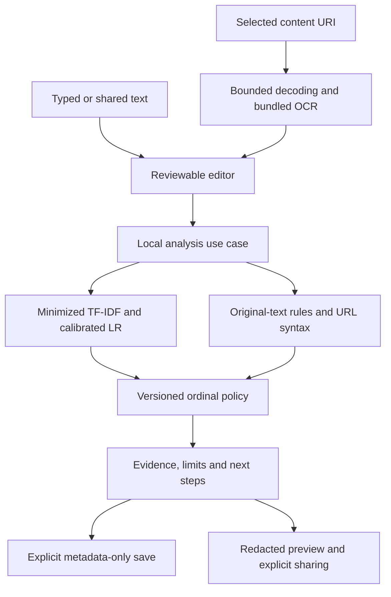

# Architecture and trust boundaries

The app has two Gradle modules: a pure Kotlin/JVM analysis core and the Android app. The app uses Compose and Material 3, lifecycle ViewModel, structured Coroutines/Flow, Navigation Compose, DataStore preferences and Room summary history. Dependency injection is a small Application-owned graph.

Untrusted inputs are text, intents, content providers, image bytes and model files. Incoming shares accept ACTION_SEND/text/plain; they never open destinations. A share replaces the current draft and cancels existing work. Editor versions and cancellation prevent obsolete results being applied. Process death deliberately discards draft content; rotation uses the ViewModel. Screenshot streams and bitmaps are bounded; source files are never copied to disk. OCR requests are serialized. A cancelled ML Kit task is allowed to finish privately before its bitmap is recycled, because its native Task is not coroutine-cancellable; stale results are still rejected by input version.

Model features first minimize email/number/URL tokens, normalize NFKC, lowercase ASCII only, collapse a fixed whitespace set, count overlapping Unicode codepoint n-grams 3..5, apply sublinear TF and smoothed train-only IDF, L2-normalize, compute three logits, divide by fitted scalar temperature and apply stable softmax. This is implemented independently in Python and Kotlin. No network client, neural runtime or Python deserializer is used on phone.

Model estimates, rule observations and lexical URL observations remain distinguishable. Policy never averages their outputs into a fake probability. Missing model, unsupported script and invalid input cannot create a lower-risk result. Observation spans are omitted rather than risking mismatched Python codepoint/Kotlin UTF-16 highlighting.

History is a separate repository and cannot block inference. Only category, fixed summary, timestamp and version metadata are saved after consent. No raw payload requires field encryption in this build. DataStore stores settings only. Backup is explicitly excluded. Export is a separate deliberate boundary with a redacted preview and narrow FileProvider cache path.
