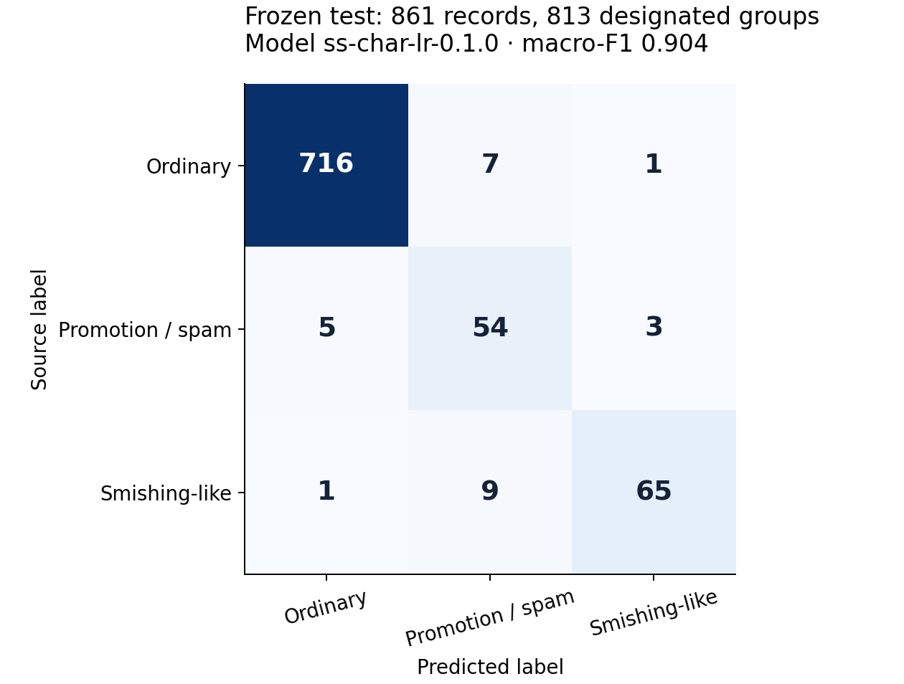
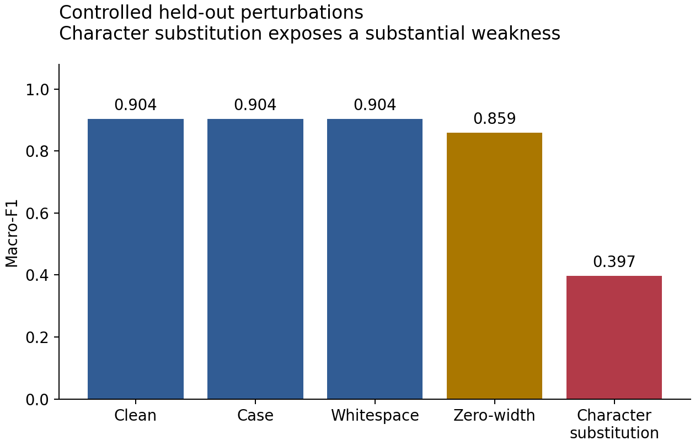
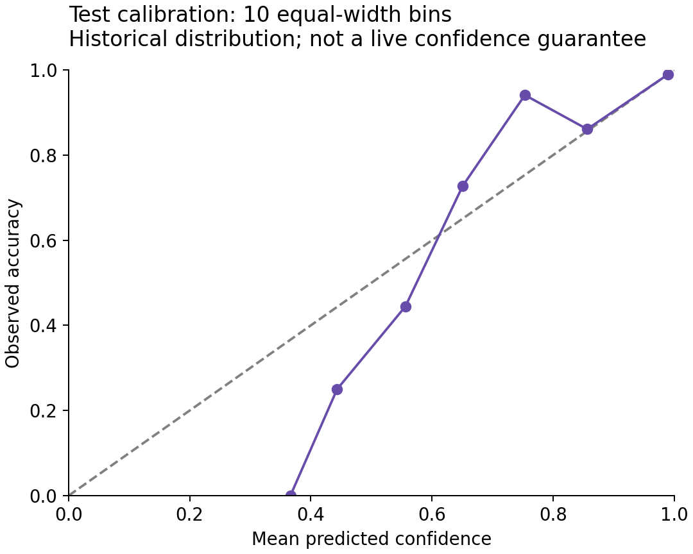

# Actual evaluation results — research preview

Frozen model `ss-char-lr-0.1.0`. Protocol `ss-group-v1`. Final-test artifact SHA-256 `14927b442dc9f33a35ad7086bd522b87e1110a73a6d1b2826b73ac1bf1a8a8fa`. All figures below are from saved aggregate files; this report does not rerun or retune the test.

The held-out set contains 861 records in 813 designated groups. Macro-F1 is **0.904**, with 95% group-bootstrap interval **0.861–0.945** (300 percentile resamples, group unit, seed 42). Accuracy is 96.98%. This is historical single-source performance, not current scam-prevention effectiveness.

| Source class | Support | Precision | Recall | F1 |
|---|---:|---:|---:|---:|
| Ordinary | 724 | 99.17% | 98.90% | 0.990 |
| Promotion / spam | 62 | 77.14% | 87.10% | 0.818 |
| Smishing-like | 75 | 94.20% | 86.67% | 0.903 |

Smishing-like detection finds 65/75 source-labelled examples; 65/69 smishing predictions are correct. Ordinary→smishing is 1/724 (0.14%), with supplementary record-binomial Wilson interval 0.02%–0.78%. Ordinary→any-nonordinary is 8/724. Group dependence and source shift limit interpretation of these intervals. Complete policy higher-risk warnings are 0/724 ordinary benchmark records; this differs from model argmax, uses minimized corpus text and must not become a claim of zero app false alarms.

Multiclass log loss: 0.10122. Brier: 0.04748, defined as mean summed squared error across three classes. ECE: 0.00764, 10 equal-width confidence bins. Smishing average precision: 0.95402; ROC-AUC: 0.99425. Average precision is not trapezoidal PR-AUC.

Selective coverage (higher/lower accepted, checking/unable abstained): 89.08%. Accepted argmax error: 1.04%; abstained error: 19.15%. Abstention is not a complete unfamiliar-input detector. Calibration temperature is fitted on 574 separate calibration records, not final test.

## Development comparisons

| Candidate | Development macro-F1 |
|---|---:|
| majority | 0.305 |
| word_lr | 0.921 |
| char_nb | 0.871 |
| char_svc | 0.890 |
| char_lr_C2 | 0.900 |
| char_lr_C4 | 0.899 |
| transparent_rules | 0.330 |
| Character-feature MLP, best early-stopped epoch | 0.862 |

The deployed character LR C2 is the strongest deployable character LR in the bounded C search. Alternative feature families remain separate research comparisons, not hidden losers. The direct Unicode character runtime has parity/integrity and maintenance advantages. Three group-aware folds within train average 0.867. The neural alternative has 128,131 parameters and no mobile export claim. The learning curve uses one seed and cannot quantify full variability.

## Robustness and error interpretation

| Frozen held-out perturbation | Macro-F1 |
|---|---:|
| case | 0.904 |
| spacing | 0.904 |
| zero_width | 0.859 |
| ocr_substitution | 0.397 |

Case and configured whitespace normalization preserve performance. Zero-width insertion reduces it; severe o→0/l→1 substitutions cause a large failure. These are controlled synthetic text variants, not measured OCR accuracy. No parameter or threshold was retuned against these final-test failures. The editable OCR step and visible uncertainty are necessary; they do not eliminate confident transcription mistakes. A new independent protocol is required before claiming an improved model.

Promotion/smishing confusion is a significant remaining error source: 9/75 smishing examples predict promotion, while 3/62 promotional examples predict smishing. One smishing record predicts ordinary. There is no independent contemporary external holdout or temporal generalization test. UCI overlaps the primary corpus substantially and is not an external validation source.

Runtime in this report is the Linux Python CPU reference only: warm p50 0.38 ms, p95 1.32 ms. It cannot be reported as phone latency. Actual Android execution, cold loading, OCR, memory, physical-device performance, fresh offline behavior and usability have independent gates.

