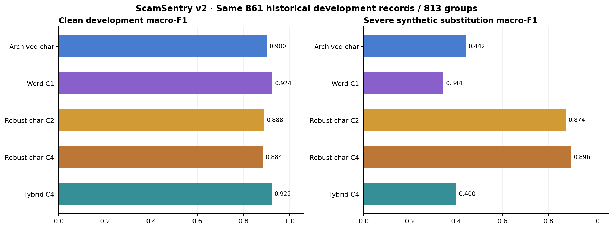

# V2 model comparison — exploratory, no model promotion

Generated from `ml/artifacts/v2/exploratory_20261116_02/summary.json`. Same development units: **861 records, 813 designated groups**, with 725 ordinary, 61 promotion/spam and 75 smishing-like records. This is historical development evidence, not a blind or contemporary external test. No old final-test prediction was rerun for this comparison. The JSON container for processed data was loaded to select allowed memberships; historical test rows were excluded before feature fitting, predictions or metric calculation. The full-pipeline comparison uses reviewed original development texts, recovered by source row. Model-only inputs use typed minimization.

Rows below are model-only. Positive class for counts is smishing-like versus both other classes. Noise is the severe synthetic all-o→0/all-l→1 slice; it is not actual OCR accuracy. Accuracy is multiclass accuracy. Size is exported research JSON, not an installed APK or measured heap.

| Candidate | Macro-F1 | Accuracy | TP | FP | TN | FN | Precision | Recall | Specificity | FPR | FNR | Smishing F1 | Noise macro-F1 | JSON bytes |
|---|---:|---:|---:|---:|---:|---:|---:|---:|---:|---:|---:|---:|---:|---:|
| archived_baseline | 90.00% | 97.10% | 68 | 9 | 777 | 7 | 88.31% | 90.67% | 98.85% | 1.15% | 9.33% | 89.47% | 44.15% | 2,369,544 |
| word_c1 | 92.43% | 97.68% | 70 | 7 | 779 | 5 | 90.91% | 93.33% | 99.11% | 0.89% | 6.67% | 92.11% | 34.35% | 1,163,031 |
| word_c4 | 92.14% | 97.68% | 69 | 7 | 779 | 6 | 90.79% | 92.00% | 99.11% | 0.89% | 8.00% | 91.39% | 40.86% | 1,158,391 |
| word_unweighted | 89.48% | 96.63% | 64 | 7 | 779 | 11 | 90.14% | 85.33% | 99.11% | 0.89% | 14.67% | 87.67% | 55.14% | 2,644,296 |
| char_robust_c2 | 88.77% | 96.52% | 63 | 7 | 779 | 12 | 90.00% | 84.00% | 99.11% | 0.89% | 16.00% | 86.90% | 87.43% | 2,523,179 |
| char_robust_c4 | 88.39% | 96.40% | 63 | 7 | 779 | 12 | 90.00% | 84.00% | 99.11% | 0.89% | 16.00% | 86.90% | 89.62% | 2,518,079 |
| hybrid_c1 | 90.38% | 96.86% | 68 | 8 | 778 | 7 | 89.47% | 90.67% | 98.98% | 1.02% | 9.33% | 90.07% | 30.45% | 3,709,315 |
| hybrid_c4 | 92.18% | 97.68% | 70 | 8 | 778 | 5 | 89.74% | 93.33% | 98.98% | 1.02% | 6.67% | 91.50% | 39.98% | 3,690,011 |
| hybrid_word_heavy | 87.27% | 95.82% | 61 | 4 | 782 | 14 | 93.85% | 81.33% | 99.49% | 0.51% | 18.67% | 87.14% | 62.04% | 3,704,976 |

The strongest development word configuration reaches 92.43% macro-F1 versus 90.00% for the preserved baseline, an absolute 0.0243 score change (2.43 percentage points). That configuration loses substantial quality under the severe substitution slice. Noise-trained character models improve that slice while reducing clean development macro-F1 and smishing recall. None satisfies all promotion conditions.

Training-only grouped CV selects **char_robust_c4**, demonstrating that CV ranking and the known development ranking differ. We do not select a deployment champion retrospectively from the most attractive table row. Keep `ss-char-lr-0.1.0` as the approved portable baseline. Actual device resource evidence and prospective validation remain unavailable.

| Candidate | Paired group bootstrap Δ macro-F1 95% CI | Pipeline coverage | Ordinary high warnings |
|---|---:|---:|---:|
| archived_baseline | +0.0000 to +0.0000 | 96.98% | 3/725 (0.41%) |
| word_c1 | +0.0007 to +0.0553 | 93.50% | 3/725 (0.41%) |
| word_c4 | -0.0026 to +0.0511 | 93.50% | 3/725 (0.41%) |
| word_unweighted | -0.0304 to +0.0193 | 93.61% | 3/725 (0.41%) |
| char_robust_c2 | -0.0490 to +0.0173 | 96.98% | 3/725 (0.41%) |
| char_robust_c4 | -0.0587 to +0.0141 | 96.98% | 3/725 (0.41%) |
| hybrid_c1 | -0.0162 to +0.0236 | 96.98% | 3/725 (0.41%) |
| hybrid_c4 | +0.0035 to +0.0445 | 96.98% | 3/725 (0.41%) |
| hybrid_word_heavy | -0.0703 to +0.0056 | 96.98% | 2/725 (0.28%) |

Paired percentile intervals use the same development group resamples for both predictions, 300 replicates, seed 42. They capture sampling variation under the designated grouping assumption, not the full uncertainty from historical data reuse, multiple comparisons or source shift. Do not treat a barely positive interval as independent validation.

Coverage here means final category other than `unable`; the historical v1 report defined acceptance more narrowly (higher/lower only). These denominators must not be mixed. Each per-candidate report stores full-pipeline counts, deferrals by class, total-population automatic smishing-high recall and accepted/abstained argmax error. Original-input deterministic observations can dominate high warnings regardless of the selected model. A high category is an indicator, not a confirmed malicious sender.

Threshold tables separately examine model-led confidence/margin gating and smishing score thresholds. They are not blended authenticity probabilities. Illustrative costs were declared before running; these costs do not estimate monetary harm. The shipped .62/.18 operating settings remain unchanged because this exploration does not justify a production threshold promotion.

The first execution (`exploratory_20261116_01`) stopped after a search-register serialization error. Its generated baseline and first word report remain preserved. The retry changed the NumPy boolean serialization only; the declared grid and scientific questions did not change. Run 02 completed every declared configuration. Inspect the experiment register for warnings and per-fold scores. Research coefficients are reproducible but are not bundled as a shipping fallback. A separate tiny fictional fit/export test verifies real scikit-learn arithmetic without distributing raw data or executable private checkpoints.
